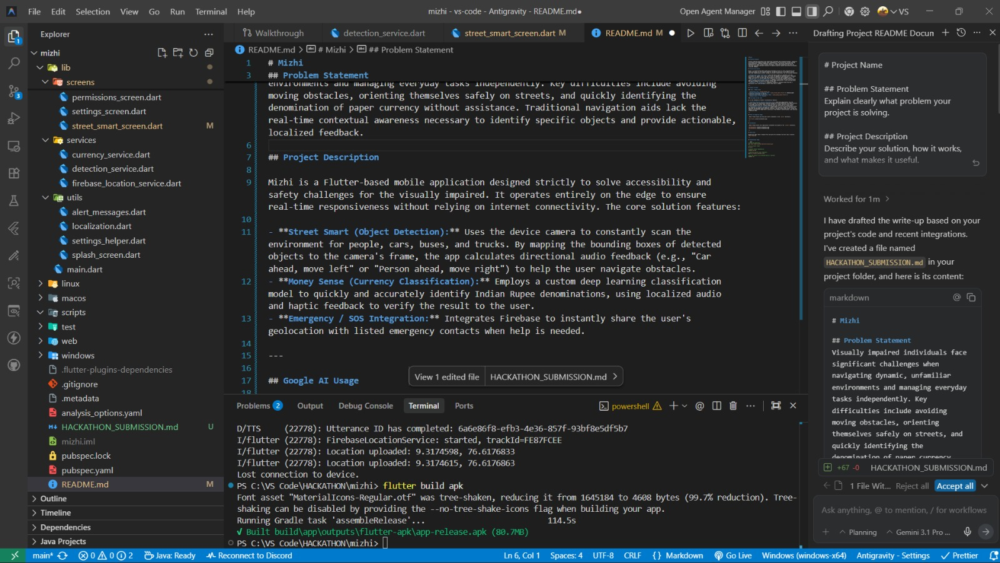
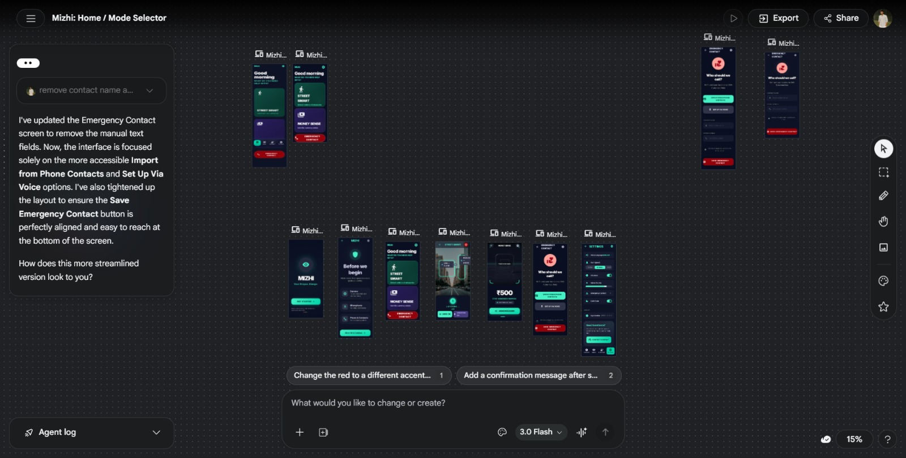

# Mizhi

## Problem Statement

Visually impaired individuals face significant challenges when navigating dynamic, unfamiliar environments and managing everyday tasks independently. Key difficulties include avoiding moving obstacles, orienting themselves safely on streets, and quickly identifying the denomination of paper currency without assistance. Traditional navigation aids lack the real-time contextual awareness necessary to identify specific objects and provide actionable, localized feedback.

## Project Description

Mizhi is an AI-powered mobile application built in Flutter designed to support accessibility for visually impaired users. Object and currency models run on the device. Speech recognition and location sharing use device services and may require internet access. The core solution features:

- **Street Smart (Object Detection):** Recognizes the model's 80 everyday object classes, including people, vehicles, laptops, bottles, phones, keyboards, chairs, bags, kitchen items, and animals. It shows object names and bounding boxes, confirms weaker detections across successive frames, and provides prioritized audio feedback. Camera processing and inference run in a persistent background worker to keep the preview responsive. Detection updates adapt to device speed, with a 120 ms minimum interval; this is separate from the camera preview frame rate.
- **Money Sense (Currency Classification):** Employs a custom deep learning classification model to quickly and accurately identify Indian Rupee denominations, using localized audio and haptic feedback to verify the result to the user.
- **Emergency / SOS Integration:** Integrates Firebase to instantly share the user's geolocation with listed emergency contacts when help is needed.
- **Voice commands:** Open either camera mode, open settings, return to the previous screen or Home, and adjust audio, vibration, language, or flashlight by speaking. One foreground speech recognizer serves all screens, pauses during spoken feedback, and restarts after normal silence. Camera modes release the camera before navigation and resume when returning.
- **App and audio languages:** English, Hindi, Tamil, Malayalam, and Telugu. The language setting immediately updates screen text, dialogs, object names, currency announcements, spoken feedback, and the speech recognition locale. Language and other preferences are saved across restarts.

## Using voice commands

Allow microphone access, then speak a complete command. Tap the microphone to start another session; this gives the command priority over automatic camera announcements. The help button shows examples in the selected language.

| Action | Example command |
| --- | --- |
| Open a mode | “Open Street Smart” or “Open Money Sense” |
| Navigate | “Open settings”, “Go back”, or “Go home” |
| Change language | “Change language to Hindi” |
| Adjust volume | “Volume up”, “Volume down”, or “Set volume to 50 percent” |
| Adjust speech | “Speak slower”, “Speak faster”, or “Set speed to normal” |
| Change feedback | “Vibration off” or “Voice on” |
| Camera light | “Flashlight on” or “Flashlight off” |
| Alert interval | “Set alert cooldown to 4 seconds” |

Native command examples include “सेटिंग्स खोलो” (Hindi), “அமைப்புகள் திற” (Tamil), “ക്രമീകരണങ്ങൾ തുറക്കുക” (Malayalam), and “సెట్టింగులు తెరువు” (Telugu). Recognition uses the selected app language. The device needs a speech recognizer and a text-to-speech voice for that language; the app displays a localized status if either is unavailable. Install missing voices through the device's text-to-speech settings. System permission dialogs follow the operating system's language.

## Mobile performance

Both camera models run in persistent background isolates. They reuse RGB input buffers and write directly to allocated TensorFlow Lite tensors, avoiding nested image lists and repeated native input/output copies. Each mode admits only one frame at a time and drops intervening frames. Money Sense adapts its scan interval to processing time, starting at 250 ms, independently of camera preview FPS.

Street Smart updates its boxes and detection status without rebuilding the camera preview and control panel for every scan. Money Sense redraws results only when the denomination or displayed confidence changes. Images decode at their display resolution, app locale rebuilds occur only for language changes, and volume settings save when the slider is released. Camera streams and scanning animations pause when navigating away or backgrounding the app. Location tracking shares one service and prevents overlapping uploads.

Only the two active models and their labels are bundled. Use a release build for normal mobile use:

```bash
flutter build apk --release --split-per-abi
```

Choose `app-arm64-v8a-release.apk` for a 64-bit ARM phone or `app-armeabi-v7a-release.apk` for an older 32-bit ARM phone. The current release configuration uses the development signing key for local testing; store distribution needs production signing. To measure real FPS, CPU, memory, and battery behavior, use `flutter run --profile` on the target phone. Desktop tests verify conversion and lifecycle behavior, not physical-device performance.

Run `flutter test tool/mobile_preprocessing_benchmark.dart --reporter expanded` to compare the previous currency conversion plus nested tensor allocation with the reusable-buffer path and verify identical RGB pixels. One Windows run measured median preprocessing at 8.31 ms before and 2.86 ms after; this excludes inference, isolate transport, and camera capture and does not predict phone FPS.

---

## Google AI Usage

### Tools / Models Used

- **Antigravity IDE**
- **Stitch AI**
- **Firebase for backend GPS**
- **Google TTS**

### How Google AI Was Used

AI is the foundation of Mizhi's accessibility features:

1. **Antigravity IDE:** Used as a core development environment to accelerate implementation and integration across the app modules.
2. **Stitch AI:** Used to support AI-assisted development workflows and improve feature iteration speed.
3. **Firebase for backend GPS:** Used to handle backend connectivity for location-based emergency/SOS GPS sharing.
4. **Google TTS:** Used to provide clear voice guidance and spoken feedback for navigation and currency detection.

---

## Proof of Google AI Usage





---

## Screenshots


.jpeg)  
.jpeg)
.jpeg)
.jpeg)
.jpeg)

---

## Demo Video

[Watch Demo](https://drive.google.com/file/d/1-6D6lfRF0qBgdeorD8Up-osKMurLOk-x/view?usp=drivesdk)

---

## Installation Steps

```bash
# Clone the repository
git clone https://github.com/sarin-ms/mizhi.git

# Go to project folder
cd mizhi

# Install Flutter dependencies
flutter pub get

# Generate Launcher Icons (Optional)
dart run flutter_launcher_icons

# Run the project on an attached device or emulator
flutter run
```
